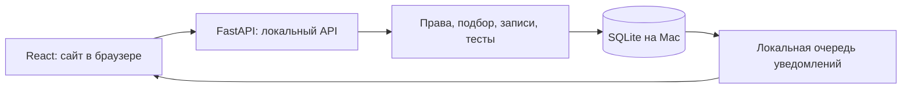

# StudyMate Campus 2.2



## Интерфейс

React + TypeScript + Vite. History API хранит адрес текущей страницы и параметры поиска. Сервер возвращает приложение для `/mentors/:id`, `/lessons/:id`, `/calendar` и остальных страниц; неизвестные API-запросы остаются ошибками. Шрифты системные, изображение локальное; Telegram SDK, внешние шрифты и CDN не используются.

```
frontend/src/
  App.tsx            маршруты, сессия, обновление данных, шапка/подвал
  api.ts             fetch-обёртка, фильтры в URL, форматирование дат и денег
  types.ts           типы, с которыми работает интерфейс
  api-schema.d.ts    типы, сгенерированные из OpenAPI бэкенда (npm run gen:api)
  api-contract.ts    проверка tsc: ответы сервера совместимы с types.ts
  ui.tsx             общие элементы: Modal, ErrorText, Avatar, Badge…
  pages/             по файлу на экран: Home, Catalog, Mentor, Auth (вход,
                     регистрация, сброс пароля), Dashboard, Lesson, Calendar,
                     Progress, Account, Team
  components/        SearchFields, MentorRow, BookingDialog, QuizDialog,
                     LessonStatus, SubjectEditor, SecurityPanel
```

`api.ts` хранит применённые фильтры в URL; поколения сессий и AbortController отбрасывают запросы прошлого аккаунта при переключении. Ошибки форм показываются внутри формы и связаны с полями через `aria-describedby`. Модальные окна — нативный `<dialog>`: фокус удерживается внутри, Esc закрывает, после закрытия фокус возвращается на кнопку-источник. Пока вкладка скрыта, опрос сервера (раз в 12 секунд) не выполняется; при возвращении на вкладку данные обновляются сразу. Ошибка рендера показывает экран «Обновим страницу?» (error boundary в `main.tsx`), а не белый экран.

Если бэкенд меняет форму ответа, `npm run gen:api` обновляет `api-schema.d.ts`, и `tsc` в `api-contract.ts` сразу показывает расхождение с `types.ts`. Так нашлось, что в карточке ментора у тем нет поля `code`, хотя тип интерфейса его обещал.

## Бэкенд

```
backend/studymate/
  api.py        фабрика приложения: настройки, БД, воркер, роутеры, SPA, заголовки
  deps.py       зависимости FastAPI: read/write-сессии, текущий пользователь, админ
  schemas.py    Pydantic-модели запросов и ответов (видны в /docs и openapi.json)
  routes/       auth, public, account, mentor, bookings, quiz, admin
  service.py    правила записи, подбора, прогресса и статистики
  quizzes.py    банк вопросов и попытки
  auth.py       пароли, токены, коды сброса, ограничение попыток входа
  db.py         движок SQLite, транзакции чтения и записи, миграции
  inbox.py      локальная очередь уведомлений и шаг автоотмены групп
  events.py     шина событий после commit, одноразовые билеты для SSE
  chat.py       треды переписки, доступ, непрочитанные
  search.py     полнотекстовый поиск (FTS5, запасной путь LIKE)
  recommend.py  чистая функция рекомендаций (без БД)
  matching.py   сигналы для рекомендаций, совпадения с листом ожидания
  reschedule.py перенос встречи по согласию
  groups.py     групповые занятия
  ics.py        генератор iCalendar (RFC 5545)
```

Роутеры используют `Router` (`routes/__init__.py`), который отдаёт ответы с `response_model_exclude_unset`: модели документируют API, но JSON остаётся прежним. Например, у теста нет ключа `feedback`, пока ответы не отправлены.

### Транзакции чтения и записи

Раньше каждый запрос, включая GET каталога, открывал `BEGIN IMMEDIATE`, то есть брал блокировку записи SQLite. Весь сайт обслуживал запросы строго по очереди. Теперь:

- `write_session` — `BEGIN IMMEDIATE` для любых изменений. Проверка «слот свободен» и резервирование по-прежнему атомарны.
- `read_session` — обычный снимок WAL без блокировки записи, в конце всегда откат. Сессия помечена как только для чтения; попытка изменить объект через неё вызывает `ReadOnlySessionError` (`before_flush`).
- Чтобы чтение видело актуальные статусы, `read_session` сначала дёшево проверяет просроченные заявки и только при их наличии переводит их в `expired` короткой отдельной транзакцией записи.

Тест `test_reads_do_not_wait_for_the_write_lock` держит блокировку записи в другом потоке и проверяет, что каталог отвечает сразу.

## Данные и перенос версии 1

SQLAlchemy и Alembic, SQLite с WAL, внешними ключами и ожиданием блокировки. Миграция `003` добавляет email/хеш пароля, независимую приостановку ментора, доступность интервала, данные встречи, отметку ментора и таблицу личных заметок. Миграция `004` добавляет таблицу одноразовых кодов сброса пароля; проверена на базе версии `003` (`PRAGMA integrity_check` — `ok`). Старые Telegram-поля оставлены в базе для совместимости; приложение их не использует и не передаёт в ответах профиля/встречи. Существующие аккаунты демонстрации доступны через отдельный демонстрационный вход.

## Учётные записи

Email нормализуется в нижний регистр, уникальность защищает база. Пароль длиной 10–128 символов (проверяется Pydantic-схемой): PBKDF2-HMAC-SHA256 с 600 000 итераций и случайной солью. Хеширование выполняется **до** открытия транзакции записи, поэтому медленный PBKDF2 не блокирует базу для остальных. Для несуществующего email выполняется такая же по стоимости проверка, чтобы время ответа не выдавало наличие аккаунта.

Сервер хранит SHA-256 от случайного токена сессии на 12 часов. Истёкший токен удаляется при первом же запросе с ним, не дожидаясь фонового воркера.

**Ограничение попыток** (`auth.RateLimiter`, в памяти процесса) использует два скользящих окна по минуте: 10 попыток на пару «адрес клиента + email» и 60 попыток на адрес. Раньше лимит считался только по адресу. На `127.0.0.1` он у всех посетителей один, поэтому 20 опечаток одного человека закрывали вход всем. Устаревшие ключи удаляются, словарь не растёт бесконечно. Это локальная защита, не распределённый сервис.

**Пароль и сессии:**
- смена пароля требует текущий пароль и завершает все остальные сессии, кроме текущей;
- «Выйти на всех устройствах» отзывает все токены пользователя;
- восстановление без email: владелец Mac при остановленном приложении выполняет `python -m studymate reset-password --email …` и получает одноразовый код на 30 минут. Код хранится только как SHA-256. Новый код отменяет предыдущий, использованный код повторно не работает, после сброса завершаются все сессии;
- «Скачать мои данные» отдаёт JSON с профилем, встречами, своими заметками, попытками тестов, прогрессом и листом ожидания. Чужие личные заметки в экспорт не попадают.

**Почему токен в sessionStorage, а не в httpOnly-cookie.** Сайт работает только на `127.0.0.1`, без HTTPS и без сторонних скриптов. Заголовок `Authorization` исключает CSRF без отдельных токенов, а `sessionStorage` очищается при закрытии вкладки. Основной риск такого хранения — XSS. Его снижают строгая CSP (`script-src 'self'`, без inline-скриптов и сторонних доменов) и React, экранирующий вывод. Для публичного запуска нужно перейти на cookie `HttpOnly; Secure; SameSite=Lax`, добавить CSRF-защиту изменяющих запросов, HTTPS, распределённое ограничение попыток (Redis или аналог) и подтверждение email.

**Заголовки безопасности:** `Content-Security-Policy` (`default-src 'self'`, `frame-ancestors 'none'`, `object-src 'none'`, `form-action 'self'`), `X-Frame-Options: DENY`, `X-Content-Type-Options: nosniff`, `Referrer-Policy: same-origin`. Для `/docs` CSP не ставится: Swagger UI загружает свои ресурсы с CDN.

Роль команды хранится в базе. В site-режиме её можно назначить локальной командой только существующей учётной записи. Демороли доступны исключительно в demo-режиме.

## Запись

Транзакция `BEGIN IMMEDIATE` объединяет проверку и резервирование. Проверяются тема/кампус/язык/формат, актуальная цена, нижняя граница времени, дедлайн, доступность ментора, отдельная приостановка и пересечения у обоих участников. Ключ запроса делает повторную отправку одной записи безопасной. Ожидающая заявка удерживает время до истечения 15 минут; отмена, отказ и истечение освобождают его. Уже состоявшаяся встреча сохраняет использованный интервал.

Подтверждение доступно только ментору этой заявки и требует места: HTTPS-ссылки без учётных данных либо аудитории. Материалы и место меняет ментор. Личные заметки имеют составной ключ «встреча + пользователь» и возвращаются только владельцу; административный просмотр не раскрывает чужие заметки.

Завершение требует отметки ментора и подтверждения студента. В site-режиме обе операции проверяют окончание времени встречи. XP за встречу начисляется обоим один раз по уникальному источнику. Отзыв — один, только от студента после завершения.

Личная доступность `active` и административная приостановка `suspended` — разные поля. Закрытие свободного интервала меняет `enabled`, не удаляет строки и историю.

## Уведомления и тесты

`inbox.py` сохраняет уведомления внутри сайта. Уникальный dedupe_key предотвращает повторные события. Устаревшие напоминания пропускаются, истёкшие сессии удаляются. Блокирующая работа с SQLite выполняется через `asyncio.to_thread`, поэтому ожидание блокировки не останавливает HTTP-цикл.

Банк тестов находится на сервере. Правильные ответы появляются только после отправки. Тесты и попытки принадлежат пользователю; post-тест доступен после завершения соответствующей встречи. XP за успешный этап темы выдаётся один раз. Три вопроса измеряют отдельные навыки, а не весь результат обучения.

Расчёт оплаты хранит снимок суммы и комиссии; не содержит платёжной интеграции и не списывает деньги. Метрики команды сопровождаются определениями; исторические демонстрационные записи не являются результатом пилота.


## Версия 2.2: архитектурные решения

### Живые обновления: SSE как подсказка

`events.EventBus` хранит подписчиков в памяти процесса. Событие — это `{"type", "id"}`: `notification`, `booking`, `thread`, `slot` и служебное `session_ended`. Содержимое сообщений в поток не уходит. Браузер, получив подсказку, перезапрашивает данные обычным API. Поэтому гарантированная доставка не нужна, повторы безопасны, а обрыв связи ничего не теряет. Опрос сервера остаётся страховкой: раз в 60 секунд при живом потоке и раз в 12 секунд без него.

- **Только после commit.** Сервис вызывает `queue_event(session, …)`, обработчик `after_commit` у Session передаёт события в шину, `after_rollback` их отбрасывает. Откат не порождает ложных уведомлений. Обработчики запросов работают в пуле потоков, поэтому доставка идёт через `loop.call_soon_threadsafe`.
- **Билет вместо токена в URL.** `EventSource` не умеет отправлять `Authorization`. Страница обменивает сессию на одноразовый билет (`POST /api/events/ticket`, 30 секунд, хранится как SHA-256) и открывает `/api/events?ticket=…`. Сессионный токен не попадает в историю и логи. Встроенное переподключение `EventSource` повторило бы использованный билет, поэтому переподключение делает хук `useEventStream` с задержкой от 1 до 30 секунд.
- **Поток не держит транзакцию.** Билет и токен проверяются короткой `db.read()`, затем отдаётся `StreamingResponse`. Раз в 15 секунд идёт heartbeat и повторная проверка токена. `logout`, «выйти везде», смена и сброс пароля закрывают потоки сразу через событие `session_ended` после commit. Не больше 5 потоков на пользователя.
- **Ограничение:** один процесс uvicorn. Для нескольких процессов нужен внешний брокер (Redis pub/sub или аналог).

### Чат встречи

`chat_messages(thread_key, sender_id, body, client_id)` и `chat_reads(thread_key, user_id, last_read_id)`. Ключ треда вычисляет только сервер: `booking:{id}` для встречи один на один, `slot:{id}` для группы.

- Писать могут участники, пока встреча ожидает или подтверждена, и ещё 7 дней после завершения. После отмены переписку можно только читать.
- Администратор доступа не имеет, как и к личным заметкам. В общем списке встреч команды счётчики непрочитанных обнулены, чтобы не раскрывать даже факт переписки.
- `UNIQUE(sender_id, client_id)` делает повторную отправку идемпотентной.
- Уведомление создаётся одно на пачку непрочитанных: dedupe-ключ `thread:{key}:{получатель}:{первое непрочитанное}`.
- Не больше 20 сообщений в минуту на пользователя. Текст показывается как обычный текст.

### Поиск, избранное, рекомендации

- **FTS5** (`mentor_search`, `unicode61 remove_diacritics 2`): имя, описание, названия тем и предметов. Индекс синхронизирует сервис (`reindex_mentor`) при правке анкеты, имени и переименовании предмета, а не триггеры: документ собирается из четырёх таблиц. CLI: `python -m studymate reindex`.
- **Безопасный запрос:** из ввода берутся только слова `\w+` длиной 2–40 символов, не больше 8, и каждое превращается в `"слово"*` (префикс, все слова через И). Сырой ввод в `MATCH` не попадает. Если FTS5 недоступен, используется запасной путь через `LIKE` с той же семантикой.
- **Байесовский рейтинг:** `(C·m + Σ) / (C + n)`, где `C = 3`, `m` — средняя оценка по всем отзывам. Одна пятёрка не обгоняет двадцать оценок 4,8. Сортировка: `soonest`, `price`, `rating`.
- **Лист ожидания оповещает:** `match_waitlist` вызывается при создании или открытии интервала и при освобождении места (отмена, отказ, истечение). Dedupe-ключ `waitlist:{id}:{slot}`. Приостановленный ментор никого не уведомляет. У уведомления есть поле `link` (`/mentors/{id}`).
- **Рекомендации:** `recommend.score_mentors` — чистая детерминированная функция над данными, без БД и без машинного обучения. Веса: слабая тема в тесте +3, интерес +1, избранное +2, прошлая встреча на 4–5★ +2, проверен командой +1, плюс (байесовский рейтинг − 3). У каждого сигнала есть человекочитаемая причина. Проверяется таблицей случаев в юнит-тестах.

### Умный календарь

- **Серия — это обычные интервалы** с общим `series_id`. Правило повторения не разворачивается при чтении, поэтому все прежние проверки (пересечения, бронирование, закрытие, история) работают без изменений. Шаг ровно 604 800 секунд: в Asia/Almaty нет летнего времени. Конфликтующая неделя пропускается через SAVEPOINT и не отменяет всю серию.
- **Перенос по согласию:** `reschedule_requests` с частичным уникальным индексом «одно ожидающее предложение на встречу». При принятии под блокировкой записи заново проверяются свободный слот и конфликты обоих участников (та же функция `find_conflict`, что при записи). `booking.slot_id` меняется на месте, id встречи сохраняется вместе с заметками, чатом, тестами и ценой. Напоминания привязаны к слоту (`notifications.slot_id`): старые помечаются `skipped`, новые создаются. Встречи один на один, только будущие.
- **.ics:** генератор без зависимостей. CRLF, перенос строк по 75 октетам UTF-8 без разрыва символа, экранирование, время в UTC, `UID` по id встречи, `SEQUENCE` растёт при переносе. Подписку по секретной ссылке сознательно не делаем: это долгоживущий токен в URL.

### Групповые занятия

- **Одна запись на каждого студента.** Заметки, тесты, отзывы, XP, расчёт оплаты и экспорт работают для каждого участника без изменений. Групповым становится сам слот: `capacity` (2–5), `topic_id`, `price` за место, `min_participants`. Общие данные (формат, ссылка или аудитория, материалы, отметка ментора, отмена) лежат в `slot_meetings`. У встреч один на один эти поля по-прежнему в `bookings`, старые данные не переносились.
- **Вместимость гарантирует база.** Частичный уникальный индекс «одна активная запись на слот» заменён на `one_active_seat_per_student (slot_id, student_id)` и триггеры `slot_capacity_insert` и `slot_capacity_update`, которые делают `RAISE(ABORT, 'slot_full')`. Сервис проверяет то же самое раньше и отдаёт понятный 409. Для `capacity = 1` поведение совпадает со старым: прежний тест гонки проходит без изменений, а новый тест с пятью потоками за последнее место даёт ровно одного победителя.
- Запись в группу сразу подтверждена: место встречи известно заранее. Другие места того же слота не считаются конфликтом ни для ментора, ни для студентов.
- Ментор отмечает завершение один раз для всей группы, каждый студент подтверждает своё. XP ментора начисляется один раз (`group:{slot}`).
- Воркер за 2 часа до начала отменяет группу, в которой меньше `min_participants`. Отмена идемпотентна через `cancelled_at`.
- Чат группы — тред `slot:{id}`. Перенос для групп недоступен.
- На существующей базе миграция 008 добавляет колонки через `ALTER TABLE` и не может добавить табличные CHECK для групповых полей. Их соблюдает сервис, а на новой базе — ещё и схема.

### Миграции 005–008

Все только добавляют и идемпотентны: проверяют существующие колонки и таблицы, потому что `001` строит таблицы по текущим моделям. Регрессионный тест `test_migrations.py` берёт **настоящую demo-базу 2.1** (`backend/tests/fixtures/v2_1-demo.sqlite3`, ревизия `004`, создана кодом 2.1) и обновляет её до `008`. Проверяется, что старые записи сохранены, `integrity_check` и `foreign_key_check` чистые, старый индекс заменён триггерами, а повторный запуск ничего не ломает.
